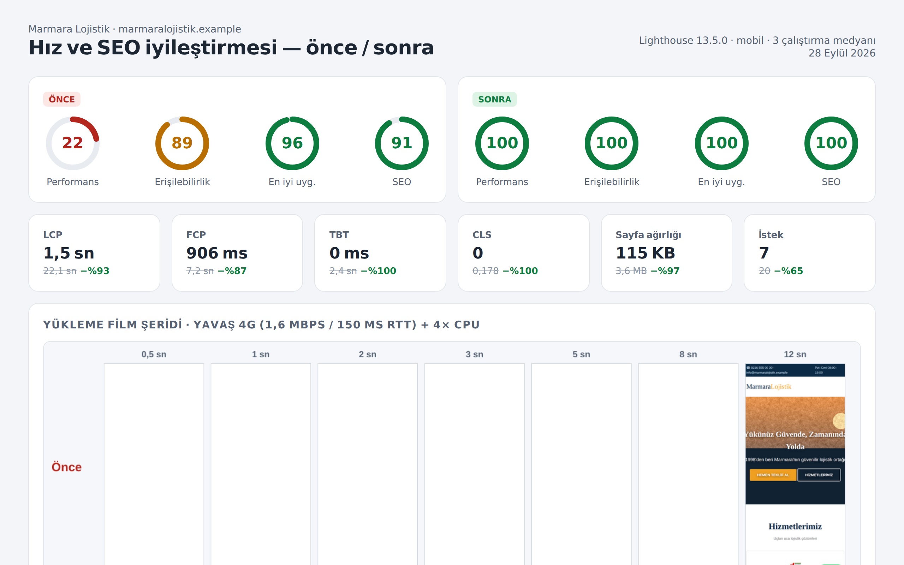
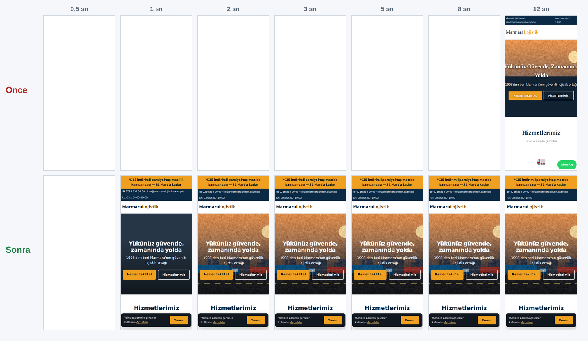

# Marmara Lojistik — Web Sitesi Hız, SEO ve Güvenlik İyileştirmesi

Kurgusal bir lojistik firmasının 2018'den kalma WordPress kurumsal sitesini **sıfırdan yazmadan, aynı içerikle** hızlandıran bakım çalışması. Depoda iki sürüm, onları ölçen betikler ve ölçüm sonuçları birlikte duruyor. Tablodaki her sayıyı `npm run all` ile yeniden üretebilirsiniz.



## Sonuç (Lighthouse mobil, 3 çalıştırmanın medyanı)

| Metrik | Önce | Sonra |
|---|---:|---:|
| Performans | **22** | **100** |
| Erişilebilirlik / En iyi uygulamalar / SEO | 89 / 96 / 91 | 100 / 100 / 100 |
| Largest Contentful Paint | 22,1 sn | 1,5 sn |
| First Contentful Paint | 7,2 sn | 0,9 sn |
| Total Blocking Time | 2.366 ms | 0 ms |
| Cumulative Layout Shift | 0,178 | 0 |
| Aktarılan veri / istek | 3,6 MB / 20 | 115 KB / 7 |

Yük testinde (25 eşzamanlı ziyaretçi, aynı makine) saniyede sunulan sayfa yaklaşık **9–10 kat** arttı (son ölçüm 220 → 2.218; değer çalıştırmadan çalıştırmaya biraz oynar). Ziyaret başına veri **3,7 MB → 111 KB**, 100 bin ziyaretteki trafik **355 GB → 11 GB** düştü. Film şeridi (yavaş 4G + 4× CPU, gerçek tarayıcı): eski sitede ekran **8 saniye boyunca beyaz** kalıyor, yenisinde 0,5 saniyede içerik görünüyor.



Ayrıntılar: [`reports/SONUCLAR.md`](reports/SONUCLAR.md). Tam Lighthouse raporları: `reports/lighthouse-once.html` ve `reports/lighthouse-sonra.html`. Müşteriye gönderilen tek sayfalık rapor: `reports/index.html`.

## "Önce" sürümü hakkında

`before/` klasörü, tipik bir 2018 kurumsal WordPress temasının **yeniden üretimidir**: aynı içerik ve aynı sorunlar. Gerçek bir müşteri sitesi değildir. Üçüncü taraf kütüphaneler depoya konmadı. Onların yerine boyut ve davranış olarak eşdeğer paketler `npm run legacy:build` ile üretiliyor. Yeniden üretilen sorunlar şunlar:

- `<head>` içinde 6 bloklayıcı stil dosyası (`@import` zinciri dahil) ve 4 senkron script (jQuery, migrate, slider, emoji) var.
- Hero görseli JavaScript slider'ın içinde. Slider `display:none` ile başlıyor ve betik çalışana kadar LCP görseli boyanmıyor. Lighthouse'un LCP öğesi `div.rev-slide`.
- 1600 px JPEG'ler (her biri ~300 KB) hem slider'da hem galeride; boyutsuz ``'ler, `alt` metni yok.
- 3 adet TTF font (toplam ~1,3 MB), `font-display` tanımı yok.
- Ana iş parçacığını 600 ms kilitleyen başlangıç betiği var.
- Çerez çubuğu ve kampanya bandı 1,2 sn sonra sayfanın üstüne ekleniyor, içerik aşağı kayıyor (CLS 0,178).
- Sunucu tarafında sıkıştırma, önbellek ve güvenlik başlıkları yok; `favicon.ico` her ziyarette 404 veriyor.

## Yapılanlar (her biri hangi metriği etkiliyor)

| Değişiklik | Etkilediği metrik |
|---|---|
| Slider kaldırıldı; hero, `<picture>` + AVIF/WebP/JPEG, `srcset/sizes`, `fetchpriority="high"` ve `<link rel=preload imagesrcset>` ile | LCP |
| Görsel hattı (`scripts/optimize-images.mjs`, sharp): 4 genişlik × 3 format; 800 px AVIF ~37 KB (eski JPEG ~300 KB) | LCP, ağırlık |
| Galeri görselleri `loading="lazy"`, `width/height` ve `aspect-ratio` ile | CLS, ağırlık |
| 1,2 MB bloklayıcı CSS/JS kaldırıldı. Sayfanın tüm stili 5 KB satır içi kritik CSS; tek betik 0,5 KB ve `defer` | FCP, TBT |
| TTF → woff2 (latin-ext, 2 ağırlık, 70 KB), `font-display: swap`, kalın yazı ağırlığı preload | FCP, CLS |
| Kampanya bandının yeri HTML'de ayrıldı; çerez bildirimi sabit konumlu katman | CLS |
| Açılış popup'ı ve 600 ms'lik bloklayan betik kaldırıldı | TBT |
| Brotli (q11), varlıklara 1 yıllık `immutable` önbellek, HTML'e `no-cache` | Aktarım, tekrar ziyaret |
| Güvenlik başlıkları: CSP, HSTS, X-Frame-Options, nosniff, Referrer/Permissions-Policy | En iyi uygulamalar |
| Meta açıklama, canonical, Open Graph, `MovingCompany` JSON-LD, `robots.txt`, `sitemap.xml`, favicon | SEO |
| Anlamlı `alt` metinleri, `lang`, içeriğe atla bağlantısı, form etiketleri ve odak halkası; marka turuncusu metinde AA kontrasta (≥ 4,5:1) koyulaştırıldı, başlık sırası düzeltildi | Erişilebilirlik |

## Gerilemeyi önleme: performans bütçesi

`budget.json` sınırları belirler: Lighthouse skorları ≥ 95, LCP ≤ 2,5 sn, TBT ≤ 200 ms, CLS ≤ 0,1, toplam ≤ 300 KB, JS ≤ 5 KB, font ≤ 80 KB, hero ≤ 60 KB. `npm test` (`scripts/check.mjs`) 24 kuralı denetler: bloklayıcı script veya stil olmaması, tüm görsellerde boyut ve `alt`, tek öncelikli görsel, LCP preload, `font-display`, SEO etiketleri, kırık bağlantı taraması, dosya ağırlıkları ve son ölçümün bütçeye uyması. CI'da her değişiklikte çalışacak şekilde tasarlandı. `SITE=before npm test` komutu eski sitenin kaç kuralı çiğnediğini gösterir.

## Çalıştırma

```bash
npm install
npm run serve:once        # http://localhost:8081  (eski sunucu profili)
npm run serve:sonra       # http://localhost:8082  (Brotli + önbellek + güvenlik başlıkları)
npm run all               # görseller → Lighthouse (3×2) → yük testi → film şeridi → rapor → bütçe kontrolü
```

Lighthouse için sistemde Chrome kurulu olmalıdır (`CHROME_PATH` ile başka bir tarayıcı da gösterilebilir). Film şeridi ve rapor Playwright ile alınır.

## Teknolojiler

HTML/CSS (framework yok), Node.js, Lighthouse 13 + chrome-launcher, Playwright (CDP ağ/CPU kısıtlaması ve ekran kaydı), sharp (AVIF/WebP/mozjpeg), Brotli.

## Lisans

MIT — Uğur Can Elsun. Inter fontu SIL Open Font License altındadır (`after/assets/fonts/LICENSE-Inter.txt`).
